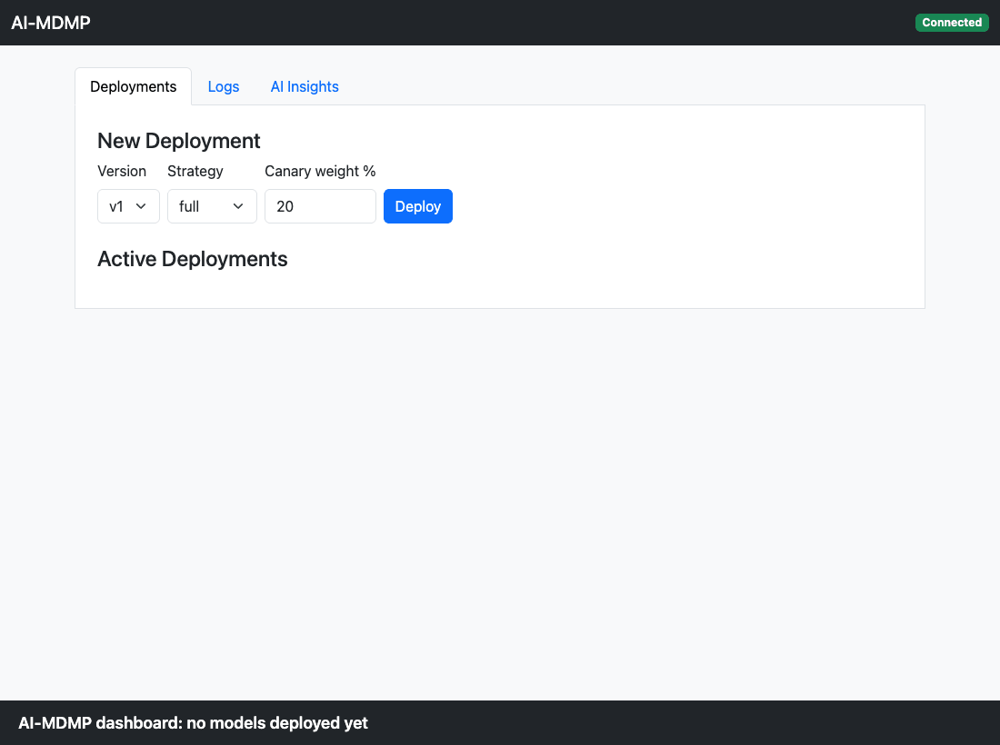

# AI-MDMP: AI-Powered Model Deployment & Monitoring Platform

[](https://github.com/Kenzoh33/ai-mdmp/actions/workflows/ci.yml)
[](https://github.com/Kenzoh33/ai-mdmp/actions/workflows/cd.yml)

AI-MDMP deploys machine-learning models to Kubernetes with **canary releases**, watches them in
production, and **rolls back automatically** when a new version misbehaves. An LLM explains each
anomaly and uses past deployments to recommend how cautiously the next release should start.

<!-- Demo recording: docs/demo.gif -->


## Features

- **Canary deployments:** a new model version gets a configurable share of traffic through an
  ingress-nginx canary Ingress (`canary-weight`), and can be scaled, promoted or rolled back.
- **Automatic rollback:** the monitor reports anomalies (error rate, p95 latency, confidence), and
  the deployer applies a rollback policy (critical → rollback, two warnings in 5 minutes →
  rollback, a 2-minute cooldown per model, and repeat events ignored).
- **AI assistance:** the monitor explains anomalies with an LLM, and `GET /feedback/risk` turns
  deployment history into a risk level and a recommended canary start weight.
- **Dashboard:** deploy, promote and roll back from the browser, with live status and AI insights.
- **Observability:** Prometheus metrics on every model (`model_requests_total`,
  `model_request_latency_seconds`, `model_prediction_confidence`), alert rules, a Grafana
  dashboard, and structured JSON logs.
- **CI/CD:** every pull request is linted, tested and built. Every push to `main` builds images
  tagged with the commit SHA, pushes them to GHCR, and proves the full canary → rollback loop on a
  temporary Kubernetes (kind) cluster.

## Architecture

```
 Browser ──► api + dashboard (:8000) ──/api/v1/*──► deployer (:8001) ──► Kubernetes (mdmp-models)
                                                       ▲                   stable + canary Deployments
                                                       │ AnomalyEvent      Services, canary Ingress
 monitor (:8002) ── LLM explanation ───────────────────┘
       ▲
       └── metrics from the sentiment models (/metrics, Prometheus)
```

| Component | Path | Role |
| --- | --- | --- |
| Api + dashboard | `services/api/`, `frontend/` | Serves the dashboard and forwards `/api/v1` to the deployer |
| Deployer | `services/deployer/` | The only service that changes Kubernetes; deployment state, rollback policy, risk feedback |
| Monitor | `services/monitor/` | Anomaly detection and LLM explanations; reports to the deployer |
| Canary analysis | `services/advanced/` | Compares canary and stable metrics and recommends rollout, hold or rollback |
| Sentiment models | `models/sentiment/` | TF-IDF + logistic regression: v1 healthy, v2 deliberately broken, v3 retrained |
| Kubernetes | `k8s/` | kind config, namespaces, model Deployments and Ingress, deployer RBAC, monitoring |
| Load generator | `loadgen/` | Steady demo traffic to the model ingress |
| Shared code | `common/` | Pydantic contracts (`schemas.py`) and the shared LLM client |

API contracts are in [`docs/CONTRACTS.md`](docs/CONTRACTS.md).

## Quick start

Requires Python 3.11+.

```bash
git clone https://github.com/Kenzoh33/ai-mdmp.git && cd ai-mdmp
python3 -m venv .venv && source .venv/bin/activate
python -m pip install -r requirements-dev.txt
cp .env.example .env            # optional: add OPENAI_API_KEY; otherwise use LLM_MOCK=true
LLM_MOCK=true python -m pytest  # no cluster, Docker or OpenAI needed
```

## Run the demo locally

Start the three services from the repo root in separate terminals. `K8S_SIMULATE=true` lets the
deployer run without a cluster: it logs each Kubernetes action instead of performing it, and
everything else (database, rollback policy, history) runs for real.

```bash
# 1. Deployer
K8S_SIMULATE=true LLM_MOCK=true PYTHONPATH=.:services/deployer \
    uvicorn mdmp_deployer.main:app --port 8001
# 2. Api + dashboard → http://localhost:8000
PYTHONPATH=.:services/api uvicorn mdmp_api.main:app --port 8000
# 3. Monitor
LLM_MOCK=true DEPLOYER_URL=http://localhost:8001 PYTHONPATH=.:services/monitor \
    uvicorn mdmp_monitor.main:app --port 8002
```

1. Open **http://localhost:8000**. Deploy **v1** with strategy **full**, then **v2** as a
   **canary** at 20%.
2. Report bad metrics for the canary (copy its id from the dashboard or `GET /api/v1/deployments`):
   ```bash
   curl -X POST localhost:8002/anomalies/analyze -H 'content-type: application/json' -d \
     '{"error_rate": 0.2, "latency_ms": 900, "baseline_error_rate": 0.01,
       "baseline_latency_ms": 100, "deployment_id": "<canary id>"}'
   ```
3. Within 5 seconds the dashboard shows v2 as **rolled_back** with the reason.
4. **AI Insights → Suggest Rollout Plan** now rates v2 as **high** risk.

To run on a real cluster (kind + ingress-nginx), follow [`k8s/models/README.md`](k8s/models/README.md)
and [`services/deployer/README.md`](services/deployer/README.md). [`k8s/smoke-test.sh`](k8s/smoke-test.sh)
runs the whole loop against it.

## CI/CD

| Workflow | Trigger | What it does |
| --- | --- | --- |
| [`ci.yml`](.github/workflows/ci.yml) | Every pull request and push | `ruff check`, `ruff format --check`, `pytest`, Docker builds of every service |
| [`cd.yml`](.github/workflows/cd.yml) | Push to `main` or a manual run | Builds images tagged with the commit SHA and pushes them to GHCR; starts kind + ingress-nginx; deploys the deployer; runs `k8s/smoke-test.sh`: v1 stable → v2 canary receives traffic → critical anomaly → automatic rollback → feedback rates v2 high risk |

## Configuration

All configuration comes from environment variables; secrets are never committed (see `.env.example`).

| Variable | Used by | Purpose |
| --- | --- | --- |
| `OPENAI_API_KEY` / `LLM_MOCK` | monitor, deployer | Real LLM calls, or canned responses for tests and offline demos |
| `DATABASE_URL` | api, deployer | SQLite by default; Postgres in the cluster |
| `DEPLOYER_URL` | api, monitor | Where to reach the deployer (default `http://localhost:8001`) |
| `K8S_SIMULATE` | deployer | `true` = no cluster needed (demo mode) |
| `MODEL_IMAGE_TEMPLATE` | deployer | Image name per version, e.g. `ghcr.io/<owner>/ai-mdmp-{model}:{version}-<sha>` |
| `PROMETHEUS_URL` | deployer | Enables metric snapshots in deployment history |

## Team

| Area | Owner |
| --- | --- |
| Steps 1, 4: `services/api`, `common/`, `frontend/` | Shane Marks |
| Steps 3, 5: `services/monitor`, `services/advanced`, `k8s/monitoring`, `tests/` | Member B |
| Steps 2, 6: `services/deployer`, `models/`, `k8s/`, `loadgen/`, CI/CD | Rochak Ghimire |

## Contributing

1. Branch from an up-to-date `main`: `git checkout -b feat/<topic>`.
2. Before pushing: `ruff check . && ruff format . && LLM_MOCK=true python -m pytest`.
3. Open a pull request; a teammate reviews and CI must pass.
4. Discuss changes to `docs/CONTRACTS.md` or `common/schemas.py` with the team first.
